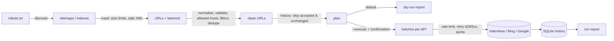

# Search Engine Indexing Toolkit

`indexkit` reads your sitemaps, cleans and de-duplicates the URLs, and notifies search engines through their official APIs: **IndexNow**, **Bing Webmaster Tools**, **Google Search Console** (sitemaps) and the **Google Indexing API** (job and livestream pages only). It is a dry run unless you pass `--execute`.

[](https://github.com/shijinb/search-engine-indexing-toolkit/actions/workflows/ci.yml)


```bash
pip install git+https://github.com/shijinb/search-engine-indexing-toolkit.git
indexkit discover https://www.example.com                                         # sitemaps from robots.txt
indexkit urls https://www.example.com/sitemap.xml --host www.example.com          # clean URL list
INDEXNOW_KEY=... indexkit submit indexnow https://www.example.com/sitemap.xml --host www.example.com   # dry run
```

> **Submitting is not indexing.** Every API here only confirms that a request was received. Search engines decide whether and when to crawl and index a page. Nothing in this toolkit can guarantee indexing or rankings.

## Contents

- [What it does](#what-it-does)
- [Supported integrations](#supported-integrations)
- [Installation](#installation)
- [Configuration and credentials](#configuration-and-credentials)
- [Usage](#usage)
- [How a run works](#how-a-run-works)
- [Safety features](#safety-features)
- [Testing](#testing)
- [Limitations](#limitations)
- [Troubleshooting](#troubleshooting)
- [Project layout](#project-layout)

## What it does

| Capability | Details |
|---|---|
| Sitemap discovery | `Sitemap:` lines in `robots.txt` |
| Sitemap parsing | `<urlset>` and `<sitemapindex>`, nested indexes, `.xml.gz`, W3C `lastmod` with time zones; hostile XML (entity expansion, external entities) rejected; 50 MB limit enforced while downloading and after decompression |
| URL hygiene | Normalisation (scheme/host case, IDN, default ports, fragments), validation, de-duplication, allowed-host check, include/exclude regexes, optional tracking-parameter removal, `--since` filter on `lastmod` |
| Submission | Batches sized per API, rate limiting, retries with exponential backoff and `Retry-After`, per-engine quotas |
| History | SQLite record of every request; unchanged URLs already accepted are skipped next time |
| Reporting | Human-readable or `--json` run reports; text or JSON-lines logs |

## Supported integrations

Verified against official documentation on 2026-10-25. Full details, limits and sources: **[docs/engines.md](docs/engines.md)**.

| Integration | Sends | Use for | Command |
|---|---|---|---|
| IndexNow | Up to 10,000 URLs/request | Any page on your host; participating search engines share submissions ([list](https://www.indexnow.org/)) | `submit indexnow` |
| Bing Webmaster URL Submission API | Up to 500 URLs/batch, within daily quota | Sites already using a Bing Webmaster API key | `submit bing` |
| Google Search Console `sitemaps.submit` | A sitemap URL | Telling Google about a new or moved sitemap | `gsc-sitemap` |
| Google Indexing API | One URL per call, 200/day default | **Only** `JobPosting` / `BroadcastEvent` pages | `submit google-indexing --confirm-indexing-api-eligible` |

Google offers **no general URL submission API**. For normal pages, keep your sitemap and `<lastmod>` accurate and submit the sitemap through Search Console.

## Installation

Requires Python 3.11+.

```bash
git clone https://github.com/shijinb/search-engine-indexing-toolkit.git
cd search-engine-indexing-toolkit
python -m venv .venv && . .venv/bin/activate
pip install -e .                 # IndexNow, Bing, sitemap tools
pip install -e ".[google]"       # + Search Console and Indexing API (google-auth)
pip install -e ".[dev,google]"   # + tests and linters
```

Dependencies: `httpx` (HTTP), `defusedxml` (safe XML parsing); `google-auth` and `requests` only for the Google integrations.

## Configuration and credentials

Secrets are read from **environment variables only**, never from command-line arguments, so they don't end up in shell history or process lists. Copy [`.env.example`](.env.example) and load it with your shell or secret manager.

| Variable | Used by | How to get it |
|---|---|---|
| `INDEXNOW_KEY` | `submit indexnow` | Generate 8–128 characters (`a-z A-Z 0-9 -`), e.g. `python -c "import secrets; print(secrets.token_hex(16))"`. Publish it at `https://<host>/<key>.txt`. |
| `BING_WEBMASTER_API_KEY` | `submit bing` | Bing Webmaster Tools → Settings → API access |
| `GOOGLE_APPLICATION_CREDENTIALS` | `gsc-sitemap`, `submit google-indexing` | Path to a service-account JSON key; add the service account e-mail as an **Owner** of the Search Console property; enable the Search Console API and/or Indexing API in Google Cloud |

## Usage

```text
indexkit [--json] [--log-format text|json] [-v] [--timeout SECONDS] COMMAND ...

discover SITE                         Sitemaps listed in robots.txt
urls SITEMAP... --host HOST           Print clean URLs (stderr: counts, errors, rejections)
submit ENGINE SITEMAP... --host HOST  Plan and (with --execute) send; ENGINE: indexnow | bing | google-indexing
gsc-sitemap SITEMAP --site PROPERTY   Submit a sitemap to Search Console
history                               Recent runs from the SQLite history
```

Options for `urls` and `submit`:

| Option | Default | Meaning |
|---|---|---|
| `--host HOST` | required | Allowed host; repeatable. Other hosts are rejected. |
| `--include REGEX` / `--exclude REGEX` | | Keep / drop matching URLs; repeatable |
| `--since DATE` | | Only URLs with `lastmod` on or after this ISO date (undated URLs kept) |
| `--strip-tracking` | off | Remove `utm_*`, `gclid`, `fbclid`, `msclkid` … |
| `--max-depth N` / `--max-sitemaps N` | 3 / 500 | Limits for sitemap indexes |

Additional options for `submit`:

| Option | Default | Meaning |
|---|---|---|
| `--execute` | off | Actually send. Without it, the run is a dry run. |
| `--yes` | off | Skip the confirmation prompt (required when not interactive) |
| `--limit N` | | Send at most N URLs this run |
| `--force` | off | Resend URLs that were accepted and haven't changed |
| `--history PATH` | `indexkit-history.sqlite3` | Submission history database |
| `--retries N` / `--min-interval S` | 3 / 1.0 | Retries for 429/5xx/network errors; seconds between API calls |
| `--site URL` | | Bing: site as registered in Bing Webmaster Tools |
| `--key-location URL` / `--endpoint URL` | `https://HOST/KEY.txt` / api.indexnow.org | IndexNow |
| `--confirm-indexing-api-eligible` | off | Required for `google-indexing` |

### Examples

```bash
# Job pages changed in the last day, sent to IndexNow
indexkit submit indexnow https://www.example.com/sitemap-jobs.xml \
  --host www.example.com --since 2026-10-24 --execute

# Same pages to the Google Indexing API (they carry JobPosting markup)
indexkit submit google-indexing https://www.example.com/sitemap-jobs.xml \
  --host www.example.com --since 2026-10-24 --confirm-indexing-api-eligible --execute

# Tell Search Console about the sitemap of a domain property
indexkit gsc-sitemap https://www.example.com/sitemap.xml --site sc-domain:example.com --execute

# In CI / cron: JSON report, JSON logs, no prompt
indexkit --json --log-format json submit indexnow https://www.example.com/sitemap.xml \
  --host www.example.com --execute --yes > report.json
```

A dry run prints the plan:

```text
run 20261025T143000Z-3fa9c1 [indexnow] DRY RUN, nothing sent
  planned: 2, unchanged since last accepted: 0, rejected: 1
  results: {'skipped': 2}
  add --execute to send
```

Exit codes: `0` success, `1` some URLs rejected/failed (or nothing could be read), `2` usage or configuration error, `3` network error.

## How a run works



This repository is both the CLI and the library (`indexkit.sitemap`, `indexkit.urls`, `indexkit.submitters.*`). A separate "sitemap library" repository was considered and not created: the sitemap and URL modules have no API dependencies and can be imported on their own, so a second package would add release overhead without adding a reusable interface.

```python
import httpx
from indexkit.sitemap import crawl
from indexkit.urls import URLPolicy, clean

with httpx.Client(timeout=30) as client:
    result = crawl(client, ["https://www.example.com/sitemap.xml"])
urls, rejected = clean((u.loc for u in result.urls), URLPolicy.for_hosts(["www.example.com"]))
```

## Safety features

- **Dry run by default**; `--execute` plus an interactive confirmation (or `--yes`) is required to send anything.
- **Allowed hosts**: URLs for any host not given with `--host` are rejected, so a compromised or misconfigured sitemap cannot make you submit someone else's URLs.
- **IndexNow key check** before sending, so a missing key file doesn't burn requests on 403s.
- **Indexing API guard**: refuses to run without explicit confirmation of eligible content; stops at the daily quota.
- **Safe XML**: `defusedxml` with DTDs forbidden; size limits before and after decompression (protects against zip bombs).
- **No secrets in logs**: credentials only from the environment; the Bing key is kept out of logged URLs; `httpx` request logging is turned down because it prints full URLs.
- **History** prevents re-sending unchanged URLs on every run, which keeps you inside quotas and away from spam heuristics.

## Testing

```bash
pip install -e ".[dev,google]"
pytest                # 63 tests
ruff check . && ruff format --check . && mypy   # mypy --strict on indexkit/
```

All search engine APIs are mocked with `httpx.MockTransport`; **the test suite never contacts a real search engine**. The tests check the documented request formats and response codes for each API, retry and `Retry-After` behaviour, quotas, the dry-run guarantee (no POST is made), confirmation and key-file checks, history-based skipping, hostile XML (billion laughs, external entities), gzip bombs and sitemap index loops.

**Verification status (2026-10-25):** all 63 tests, ruff and `mypy --strict` pass locally on Python 3.12. Sitemap discovery and parsing were also run read-only against a real public site (www.sitemaps.org). **Live submissions to IndexNow, Bing and Google have not been made from this repository**; the request formats are implemented from the official documentation listed in [docs/engines.md](docs/engines.md) and checked by the mocked tests.

## Limitations

- Google Indexing API batching (multipart, up to 100 calls per HTTP request) is not implemented; each URL is one call.
- Bing's quota response is parsed as `{"d": {"DailyQuota": N}}` per the API's JSON format; if Microsoft changes it, `submit bing` stops with an error rather than guessing.
- `lastmod` is trusted as given. If your CMS updates it on every request, every URL will look changed. Fix the sitemap first.
- History is a local SQLite file. Concurrent runs against the same file are not coordinated; run one at a time per history file.
- URL normalisation does not lower-case paths or reorder query parameters, because both can change which page a URL refers to.

## Troubleshooting

| Symptom | Likely cause | Fix |
|---|---|---|
| `IndexNow key check failed: … returned HTTP 404` | Key file not published at `https://HOST/KEY.txt` | Upload it, or pass `--key-location` |
| IndexNow `422` for every URL | URLs not on `--host`, or `www.` vs bare domain mismatch | Use the exact host from the sitemap URLs |
| IndexNow `429` | Too many submissions | Fewer, larger batches; only changed URLs (`--since`); history is on by default |
| `refusing to submit without confirmation` | Non-interactive run | Add `--yes` once you've reviewed a dry run |
| Search Console `403` | Service account is not an Owner of the property, or API not enabled | Add the account e-mail in Search Console → Settings → Users; enable the API |
| Search Console `404` | `--site` doesn't match the property | Use `sc-domain:example.com` for domain properties, the exact prefix with trailing slash otherwise |
| Indexing API `403` / `429` | API not enabled, account not Owner, or 200/day quota used | See [docs/engines.md](docs/engines.md); the API only accepts job/livestream pages |
| `deeper than --max-depth` | Nested sitemap indexes | Raise `--max-depth` if the nesting is intentional |

## Project layout

```
indexkit/
  sitemap.py        discovery, fetch with limits, parsing, index crawl
  urls.py           normalisation, validation, policy, batching
  http.py           retries, Retry-After, rate limiting
  history.py        SQLite submission history
  runner.py         plan → dry run / execute → report
  submitters/       indexnow.py, bing.py, google.py, base.py
  cli.py, logging.py
docs/engines.md     verified API capabilities and sources
tests/              63 tests; fixtures include hostile XML
```

## Licence and contributing

MIT; see [LICENSE](LICENSE). Contributions: [CONTRIBUTING.md](CONTRIBUTING.md). Security reports: [SECURITY.md](SECURITY.md). Changes: [CHANGELOG.md](CHANGELOG.md).
